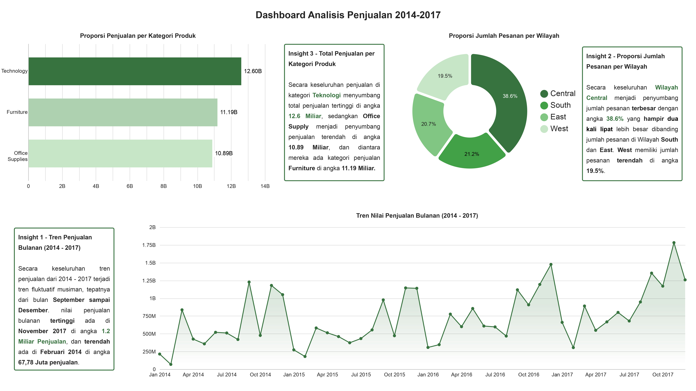
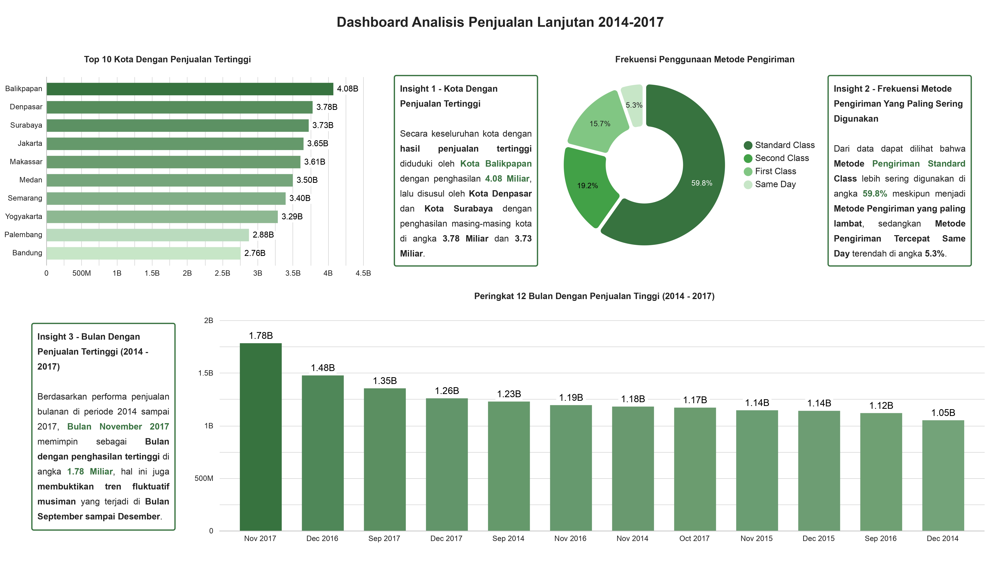

# Indonesian Supermarket Business Analytics & Profit Prediction
[](#)
[](#)
[](#)
[](LICENSE)

End-to-end retail data analytics pipeline and profit forecasting case study. This project covers data cleaning and SQL querying in Google Sheets, interactive business intelligence reporting in Google Looker Studio, and regression modeling in Orange Data Mining.

📊 **[Live Interactive Dashboard (Google Looker Studio)](https://datastudio.google.com/reporting/09a8a8c3-e429-4eff-a846-4219ec9c18c7)**  
📊 **[Processed Dataset & SQL Queries (Google Sheets)](https://docs.google.com/spreadsheets/d/142im_sGpXznoCLqvTuJfv3CQy_zkEcfHG42PeNooqbc/edit?usp=sharing)**

---

## 1. Executive Summary & Business Problem
A retail supermarket chain in Indonesia recorded multi-year transactional data (2014–2017) spanning customer segments, shipping methods, product categories, and regional sales. Raw transactional logs suffered from data quality issues including duplicate entries, missing shipping dates, unstandardized city names, and missing postal codes.

**Objectives:**
1. Clean and standardize the transactional database without losing critical records.
2. Uncover historical sales trends, top-performing products, and regional demand patterns (2014–2017).
3. Build and evaluate regression models to predict store profit (`keuntungan`) based on transaction attributes.

---

## 2. Data Cleaning & Spreadsheet Analysis (Google Sheets)

The raw transactional database required extensive cleaning across missing values, casing anomalies, and invalid records before analysis. 

### Data Quality & Processing Logic
* **Deduplication & Zero-Value Filtering:** Dropped duplicate transaction rows and removed invalid records where sales were recorded as zero.
* **City Standardization & Imputation (`clean_kota`):** Resolved mixed casing (e.g., `JAKARTA` vs `Jakarta`) and imputed missing city values using provincial lookups mapped against `reference_province_to_city`.
* **Postal Code Imputation (`clean_kode_pos`):** Populated missing postal codes by cross-referencing district tables in `reference_postal_code`.
* **Date Parsing & Domain-Aware Imputation (`clean_tanggal_pengiriman`):** Standardized disparate raw date formats and imputed missing shipping timestamps by analyzing historical fulfillment lead times across delivery tiers, applying class-conditional median offsets:
  * **Same Day:** 0-day offset (same-day dispatch)
  * **First Class:** 2-day median offset (empirical range: 1–4 days)
  * **Second Class:** 3-day median offset (empirical range: 1–5 days)
  * **Standard Class:** 5-day median offset (empirical range: 3–7 days)

---

### Analytical Findings & Breakdown

#### 1. Baseline Performance (`basic_analysis`)
* **FY 2016 Sales:** Generated **Rp9,246,372,270** across **9,936** units sold.
* **Fulfillment:** Recorded **1,548** orders utilizing First Class shipping between 2014 and 2017.

#### Conditional aggregation used to compute total gross sales for the 2016 fiscal year (basic_analysis):
``` excel
=SUMIFS(sources!R:R, 
  sources!C:C, ">=2016-01-01", 
  sources!C:C, "<=2016-12-31")
```

#### 2. Regional & Operational Patterns (`query_analysis`)
* **Volume vs. Basket Size:** **Makassar** (1,103 orders) and **Surabaya** (1,101 orders) drove the highest transaction frequency, whereas **Balikpapan** generated the highest average order value at **Rp4,085,451** per transaction.
* **Order Day Seasonality:** Transaction volume heavily concentrated at the start and end of the week, peaking on **Monday** (1,887 orders) and **Friday** (1,836 orders), with mid-week activity dropping to a low on **Wednesday** (374 orders).

#### SQL query used to aggregate customer density per city (`query_analysis`):
```sql
=QUERY(sources!A:X, 
  "SELECT X, COUNT(A) 
   WHERE X IS NOT NULL 
   GROUP BY X 
   ORDER BY COUNT(A) DESC 
   LABEL X 'Kota', COUNT(A) 'Jumlah Pelanggan'", 1)
```

#### 3. Top Revenue Drivers (`top_lima_produk`)
The top 5 grossing products generated over Rp2.3B in cumulative sales:
1. **Mesin Fotokopi 5577:** Rp923,997,360
2. **Ordner Arsip A4 9062:** Rp411,800,760
3. **Mesin Laminating 5722:** Rp339,577,200
4. **Kursi Kantor 8559:** Rp328,058,640
5. **Binder Kancing A4 9759:** Rp297,352,185

#### SQL query used to filter and extract top 5 revenue-generating products from 2014 to 2017 (top_lima_produk):
``` sql
=QUERY(sources!A:X, 
  "SELECT Q, SUM(R) 
   WHERE Q IS NOT NULL AND YEAR(C) >= 2014 AND YEAR(C) <= 2017 
   GROUP BY Q 
   ORDER BY SUM(R) DESC 
   LIMIT 5 
   LABEL Q 'Nama Produk', SUM(R) 'Total Penjualan'", 1)
```
#### 4. Multi-City Sales Distribution (`pivot_penjualan_kota_per_produk`)
* Aggregated product-level performance across 10 major Indonesian cities, establishing a total gross sales baseline of **Rp34,679,574,266**.
  | Rank | City | Total Gross Sales | % of Total Revenue |
  | :---: | :--- | :---: | :---: |
  | **#1** | **Balikpapan** | Rp4,077,279,974 | 11.76% |
  | **#2** | **Denpasar** | Rp3,782,659,375 | 10.91% |
  | **#3** | **Surabaya** | Rp3,727,291,065 | 10.75% |
  | **#4** | **Jakarta** | Rp3,653,708,952 | 10.54% |
  | **#5** | **Makassar** | Rp3,609,861,580 | 10.41% |
  | **#6** | **Medan** | Rp3,500,616,320 | 10.09% |
  | **#7** | **Semarang** | Rp3,399,510,591 | 9.80% |
  | **#8** | **Yogyakarta** | Rp3,288,278,904 | 9.48% |
  | **#9** | **Palembang** | Rp2,878,666,068 | 8.30% |
  | **#10** | **Bandung** | Rp2,761,701,437 | 7.96% |
  | — | **Grand Total** | **Rp34,679,574,266** | **100.00%** |
  
---

## 3. Business Intelligence Dashboard (Google Looker Studio)
Designed a two-page interactive dashboard applying Gestalt principles, intentional color palettes (highlighting key outliers), and metric scorecards for rapid executive decision-making.

🔗 **[Launch Interactive Looker Studio Dashboard](https://datastudio.google.com/reporting/09a8a8c3-e429-4eff-a846-4219ec9c18c7)**

### Executive Overview (Tab 1)

* **Sales Growth & Macro Trends:** Sustained annual revenue expansion across 2014–2017, with total multi-year sales surpassing **Rp34.6B**.
* **Regional Distribution:** Order volume concentrated heavily in core economic hubs (Western & Central Indonesia), requiring localized inventory hubs to optimize delivery times.
* **Category Contribution:** Product category revenue was led by high-ticket items, with **Teknologi** and **Office Supplies** generating the bulk of operating margins.

### Operational Deep-Dive (Tab 2)

* **Top Revenue Markets:** **Balikpapan** led gross sales (Rp4.07B), followed closely by **Denpasar** and **Surabaya**, driven by high average transaction values rather than raw order counts.
* **Customer Fulfillment Behavior:** Overwhelming preference for cost-effective shipping tiers (**Standard Class**), suggesting retail customers prioritize discounted delivery fees over expedited transit.
* **Peak Seasonality:** Historical transaction spikes clustered in **Q4 (November–December)**, aligning with national retail events, holiday discounts, and corporate end-of-year procurement cycles.

---

## 4. Predictive Analytics (Orange Data Mining)
Built a machine learning regression pipeline (`models/analisis-prediktif-supermarket.ows` via Orange v3.40+) to forecast store profit (`keuntungan`) and evaluate model performance across transactional features.

### Pipeline Architecture
1. **Target & Feature Selection (`Select Columns`):**
   * **Target Variable:** `keuntungan` (numeric continuous)
   * **Features:** Numerical attributes (`penjualan`, `kuantitas`, `diskon`) and categorical predictors (`kategori`, `sub_kategori`, `segmen`, `clean_kota`).
2. **Preprocessing:** Applied categorical one-hot encoding/continuization to map nominal categories without introducing ordinal bias.
3. **Model Validation:** Evaluated via the **Test and Score** widget to benchmark baseline linear modeling against an ensemble decision-tree regressor.

### Model Performance Comparison
| Model | RMSE | MAE | sMAPE (%) | R² Score |
| :--- | :---: | :---: | :---: | :---: |
| **Random Forest** | 2,342,783.73 | 332,440.45 | 36.99% | **0.575** |
| **Linear Regression** | 3,229,210.37 | 916,219.79 | 122.15% | 0.192 |

### Key Analytical Takeaways
* **Non-Linear Dynamics:** **Random Forest** significantly outperformed Linear Regression, increasing the explained variance from **19.2% ($R^2 = 0.192$)** to **57.5% ($R^2 = 0.575$)**.
* **Error Reduction:** Random Forest cut the Mean Absolute Error (MAE) by roughly **63.7%** (from ~Rp916K down to ~Rp332K) and dramatically lowered symmetric MAPE from **122.15%** to **36.99%**.
* **Business Implication:** Profit margins in this retail environment do not scale linearly with sales volume due to non-linear discount thresholds and category-specific cost margins, making tree-based ensemble methods much better suited for financial forecasting.
---

## 5. Technology Stack & Tooling

| Domain | Technology / Tool | Application |
| :--- | :--- | :--- |
| **Spreadsheet Modeling** | Google Sheets, Microsoft Excel | Data cleaning, type coercion, conditional imputation |
| **Database Querying** | Google Visualization API (`=QUERY()`) | In-sheet SQL aggregation, filtering, and sorting |
| **Business Intelligence** | Google Looker Studio | Multi-page interactive dashboard, KPI scorecarding |
| **Machine Learning** | Orange Data Mining (v3.40+) | Feature encoding, regression modeling, and performance scoring |

---

## 6. How to Run & Inspect

1. **Spreadsheet Analysis:** Open `data/preprocessed/synthetic_store_indonesia.xlsx` or view the read-only [Google Sheets Workbook](https://docs.google.com/spreadsheets/d/142im_sGpXznoCLqvTuJfv3CQy_zkEcfHG42PeNooqbc/edit?usp=sharing) to inspect live formulas and pivot calculations.
2. **Interactive BI Report:** Access the live dashboard directly on [Google Looker Studio](https://datastudio.google.com/reporting/09a8a8c3-e429-4eff-a846-4219ec9c18c7).
3. **Orange ML Workflow:** Open Orange Data Mining (v3.40 or newer), navigate to `File > Open`, and select `models/analisis-prediktif-supermarket.ows`.
